Annexes : [Human as a Service](https://pawmatch.marc-antoinemarie.com) · [Influence of Gods](https://github.com/Marc-AntoineMarie/influence_of_god) · [Pokédex](https://github.com/Marc-AntoineMarie/pokedex_react)

**[mmarie.galaxie@gmail.com](mailto:mmarie.galaxie@gmail.com)** · [LinkedIn](https://www.linkedin.com/in/marc-antoine-marie-6a132820a) · Une partie de mon travail vit dans des repos privés, j'en parle volontiers en entretien.
